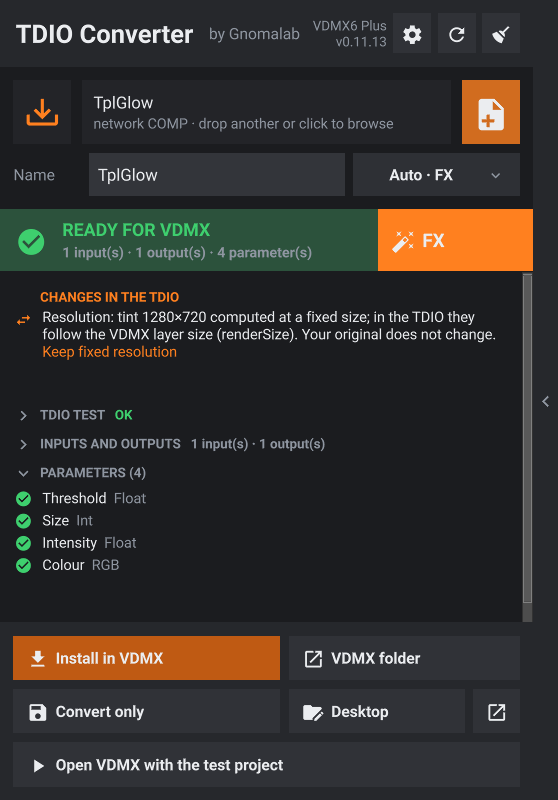

# TDIO Converter for VDMX6 Plus

**Turn any TouchDesigner component (`.tox`) into a TDIO that VDMX6 Plus can load, test it live, and install it in the right VDMX folder.**

By [Gnomalab Estudio](https://www.gnomalab.es) · Juanjo F.R.

VDMX6 Plus is the only VDMX edition that can run TouchDesigner components (TDIO). A TDIO has a strict contract: one root `baseCOMP`, a single `Custom` parameter page, a `Rendersize` parameter, `inputImage` / `outputImage` operators, and so on. This tool reads your component, checks it against that contract, wraps it (your original stays untouched inside) and saves a ready-to-use TDIO.

▶ **Demo video:** [watch on YouTube](https://www.youtube.com/watch?v=Vizdxj-I-rU) (a lighter copy is in [docs/](docs/TDIO_Converter_demo.mp4))

## What it does

- **Detects the type** automatically: FX, Source, Text Source or Plugin (you can force it).
- **Reports** inputs and outputs as VDMX will name them, parameters (valid, converted, unsupported) and external files.
- **Catches broken image flow**: a disconnected output, an FX that ignores its input, bypassed or locked operators. Offers a one-click **Repair** when the fix is unambiguous.
- **Converts unsupported parameters**: XYZ / XYZW become separate Floats, File becomes Str, and so on.
- **Ties fixed-resolution operators to `Rendersize`**, so the TDIO follows the layer size VDMX gives it.
- **Test bench**: loads the saved TDIO the way VDMX would, feeds it test images at any size, and warns about a black output, an output that ignores `renderSize`, an FX whose output does not react to its input, errors and CPU cost.
- **Installs** into the VDMX folder of the right type (asks before overwriting), or **Convert only** to save it anywhere.
- **18 starter templates** (FX, Source, Text Source, Plugin) built into the converter, with help text on every parameter.
- Interface in **English and Spanish**.

## What is in this repository

| File | What it is |
|---|---|
| `TDIO_Converter.tox` | The converter. A private component: it works normally, its inside is locked. |
| `TDIO_Converter_Demo.toe` | Ready-made project with the converter. Keep it in the same folder as `TDIO_Converter.tox`. |
| `Templates/` | The 18 starter templates as plain `.tox` files (they are also built into the converter). |
| `TDIO Converter - User Guide.pdf` | Step-by-step guide. |
| `docs/` | Screenshot and demo video. |

## Quick guide

1. **Load** a component: drag a COMP from your network or a `.tox` from your files onto the converter, or click the drop zone to browse. Or start from the orange **Template** button.
2. **Read the report.** The status bar says what you have: green = ready, amber = ready with warnings, red = cannot be converted yet. Warnings are always on top; click **Repair** when it is offered.
3. **Check name and type.** The name is editable; the type button (*Auto · FX*) forces FX, Source, Text Source or Plugin.
4. **Test it.** Open the *TDIO test* section (or the large test view) to see the saved TDIO working at any layer size, with the same parameters and ranges VDMX will show.
5. **Install.** *Install in VDMX* (Mac) puts it in the right VDMX folder; *Convert only* saves it wherever you choose.
6. **Use it in VDMX.** Add the TDIO to a layer. If you replaced an existing one, remove it and add it again, or restart VDMX.

The PDF user guide has the full walkthrough.

## Updates

On the converter's *Beta Tester* parameter page, **Check for Updates** looks for the latest version published on this repository's [Releases](../../releases) page and shows a download link when there is a newer one. *Check on Start* does it silently each time the project opens. Nothing else is ever sent.

## Requirements

- TouchDesigner **Pro**, Commercial or Education (build 2025.31550 tested). The Non-Commercial license cannot be used with VDMX.
- **VDMX6 Plus** to use the resulting TDIO.
- macOS to install straight into VDMX. VDMX only exists on Mac: on Windows the converter runs, but *Install in VDMX* and *Open VDMX* are disabled, so use *Convert only* and copy the result by hand. Windows has not been tested yet.

## Install

1. Download the package from the [Releases](../../releases) page (or this repository: Code > Download ZIP).
2. Open `TDIO_Converter_Demo.toe`, or drag `TDIO_Converter.tox` into any TouchDesigner project (an empty one is fine).

VDMX reads TDIOs from `~/Library/Application Support/VDMX/` (`TouchDesignerFX`, `TouchDesignerSources`, `TouchDesignerTextSources` and `plugins`).

## VDMX and TDIO documentation

- [Using TouchDesigner with VDMX6 Plus](https://docs.vidvox.net/vdmx/vdmx_touchdesigner.html), including the [required operators by folder](https://docs.vidvox.net/vdmx/vdmx_touchdesigner.html#_3-required-operators-by-folder)
- [Tutorial: creating custom video FX for VDMX6 Plus with TouchDesigner](https://vdmx.vidvox.net/tutorials/creating-custom-video-fx-for-vdmx6-plus-with-touchdesigner)

## Other work

[TDIO-4-VDMX6-PLUS](https://github.com/Gnomalab/TDIO-4-VDMX6-PLUS): a collection of ready-made TDIOs by Gnomalab for VDMX6 Plus.

## License

[MIT](LICENSE). The panel embeds subsets of the Roboto font and the Material Design Icons font, both under the Apache License 2.0.
